<div align="center">

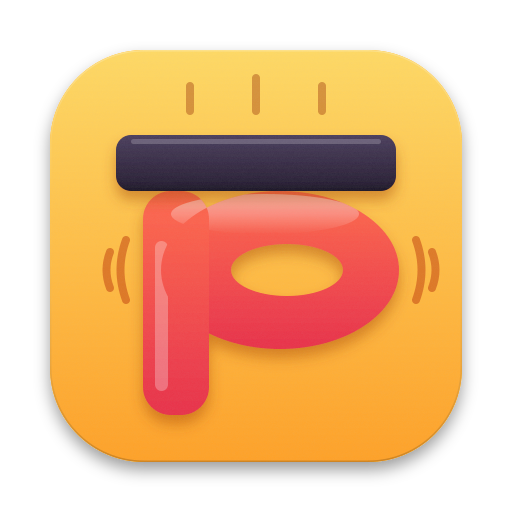

# pdfs • by kash

**Kash's PDF compressor. Add, review, compress — on your Mac, nothing uploaded.**

A small native macOS utility that shrinks PDFs locally with Ghostscript, built around a calm
“add files → check settings → compress → see results” workflow.

[What Pdfs by Kash changes](docs/pdfs-by-kash-changes.md) · [Design history](#design-history) · [Run locally](#run-locally) · [Original project](docs/UPSTREAM-README.md) · [AGPL-3.0 license](LICENSE)

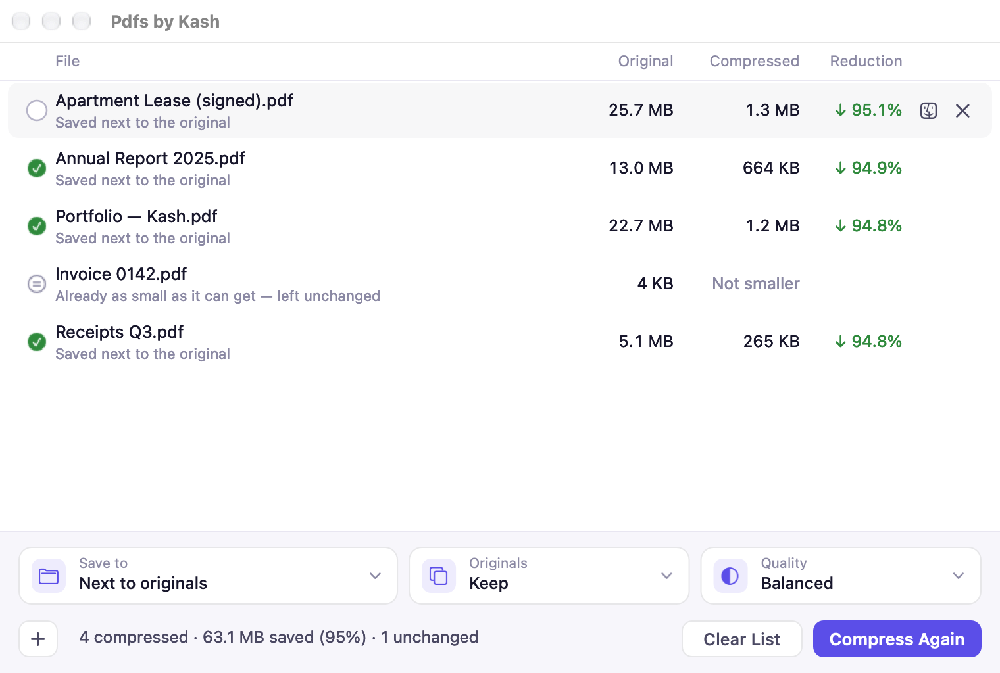

</div>

## The Pdfs by Kash approach

Pdfs by Kash is developed and maintained by **Kash (Kaschief Johnson)**. It began as a fork
of [FS PDF Compressor](https://github.com/gitlares/fs-pdf-compressor) by Daniel Lares and keeps
its engine — Ghostscript, with upstream's careful file-safety checks — while reshaping the Mac
app around a few rules shared with Kash's other apps (Geminio, Budget):

- **Nothing happens until you ask.** Adding files only lists them. Compression starts with
  **Compress**, never by itself.
- **Nothing is hidden or ambiguous.** Where each file will go, what happens to the original and
  the quality are always on screen, in words.
- **Nothing moves under the pointer.** Controls keep fixed places; things that don't apply grey
  out instead of disappearing.
- **Quiet by default.** One accent colour, hairline borders, hover feedback only on what you can
  click, focus rings only for keyboard use, tooltips only for detail you can't already see.

## What Pdfs by Kash adds

Everything FS PDF Compressor does on the Mac, plus the changes below.
**[What Pdfs by Kash changes](docs/pdfs-by-kash-changes.md)** is the running list behind this
digest — each change, the problem it solves and its limits — and it is updated with every change.

**Workflow**

- **Add, review, then compress.** Drop files or folders on the window, the Dock icon, the Drop
  Zone or Finder's **Add to Pdfs by Kash** — they're listed, not processed. Add more any time,
  even mid-batch; they wait for the next run.
- **Sizes before and after.** Original, Compressed and Reduction columns, with a total saved.
- **Clear states.** Newly added files carry no badge. After **Compress**: Queued → Compressing
  (with a row progress line) → Completed, Not smaller, or Failed with the reason in plain words.

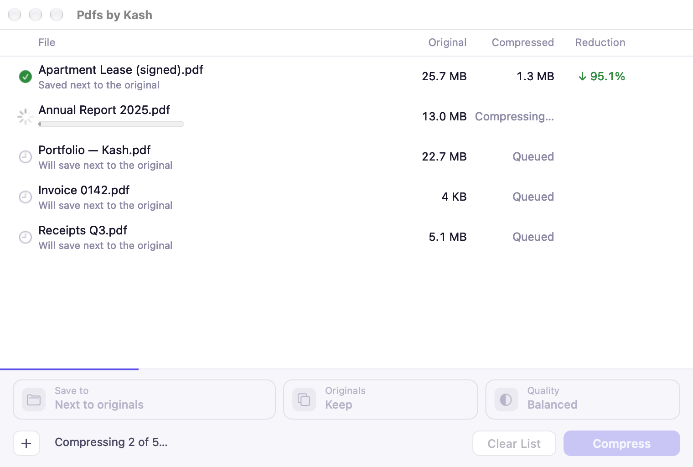

**Settings that stay in view**

- **Three tiles: Save to · Originals · Quality.** Click one for a small card of choices, each
  with one line of explanation. The tiles never change width, so nothing shifts.
- **Save to** next to each original (`name compressed.pdf`) or a folder you choose (the original
  name is kept; `name 2.pdf` if taken). Every row says where its file will go, or went.
- **Keep or Replace originals.** Keep is the default and every launch starts there, so a one-off
  Replace never carries over. Quality and Save to are remembered.

<p align="center">
  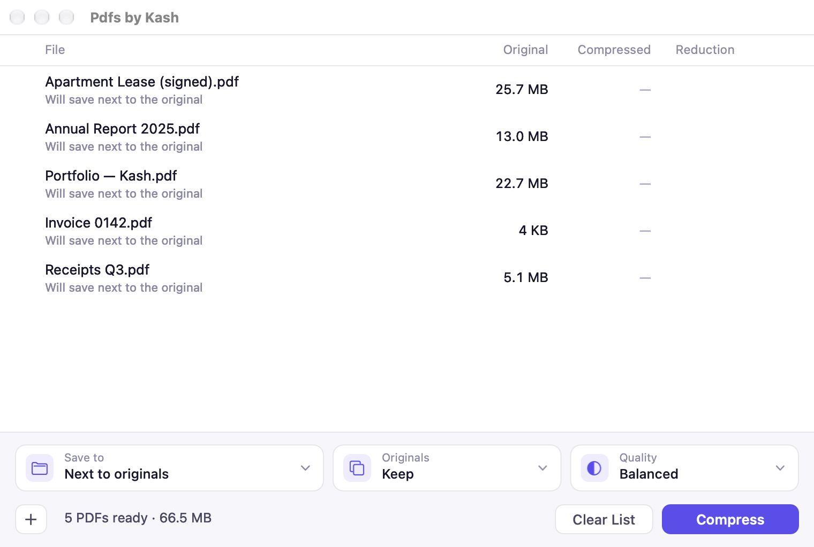
  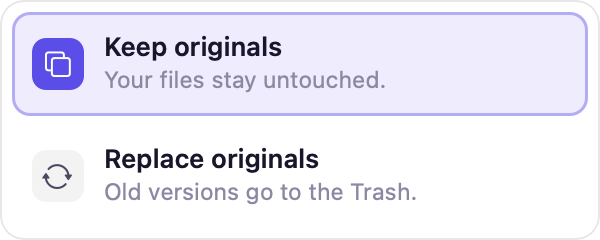
</p>

**Safe replacing**

- **An original is replaced only once it's in the Trash.** The compressed file is created and
  checked first; then the original goes to the Trash; only then does the new file take its place.
  If the Trash isn't available (some network or external drives), the original is left as is and
  the row says so. *(Upstream replaced anyway in that case.)*
- **A calm confirmation** the first time — “Replace these 4 PDFs with smaller versions? The
  originals go to the Trash, so you can get them back.” — with **Don't ask again**.

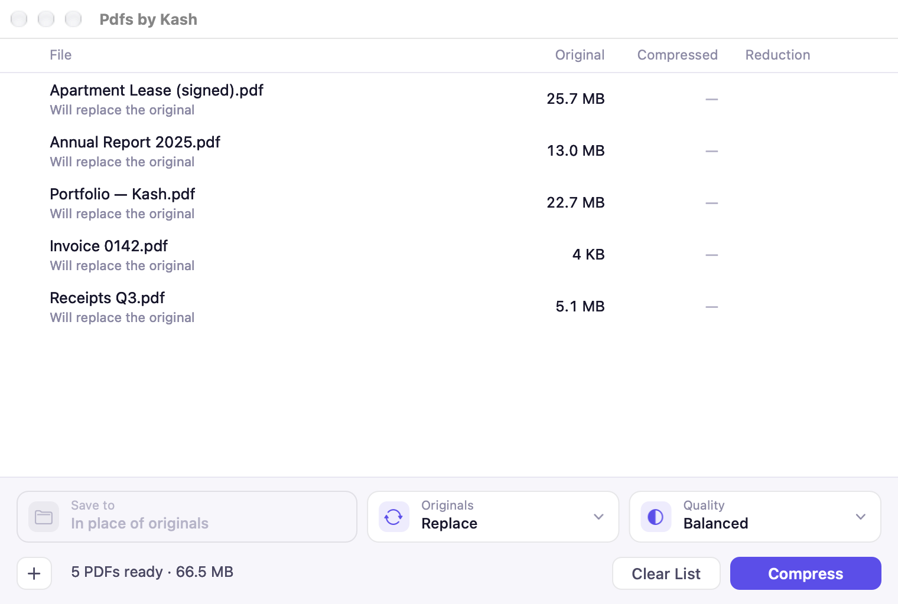

**Selecting and finding files**

- **Pick files one by one** with the circle that appears on hover — no ⌘ needed (⌘ and ⇧ still
  work). A floating bar offers **Show in Finder**, **Remove from List** and **✕** (or Esc) to deselect.
- **Selection never changes what Compress does** — it always covers every ready file, and the
  footer says so while files are selected.
- **Show in Finder** on hover (Finder icon), double-click, right-click or ⌘R. Open and Copy Path
  are in the right-click menu. **Clear List** empties the list; files on disk are never touched.

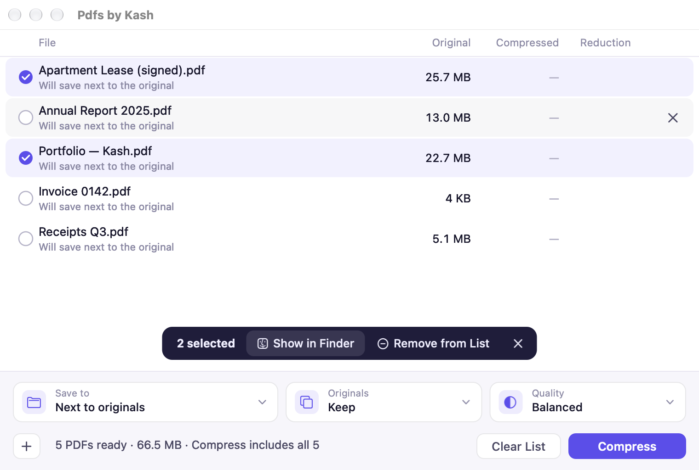

**Settings window (⌘,)**

- **Eight app icons**, Squish by default. The choice shows in the Dock and app switcher at once,
  and on the kept-in-Dock tile while the app is closed (a small Dock tile plug-in inside the app).
  Finder and Launchpad always show Squish: changing a signed app's own file icon would break its
  code signature.
- **Theme:** System, Light or Dark. Both choices survive restarts.
- That's all Settings holds — everything about compressing lives on the main screen.

<p align="center">
  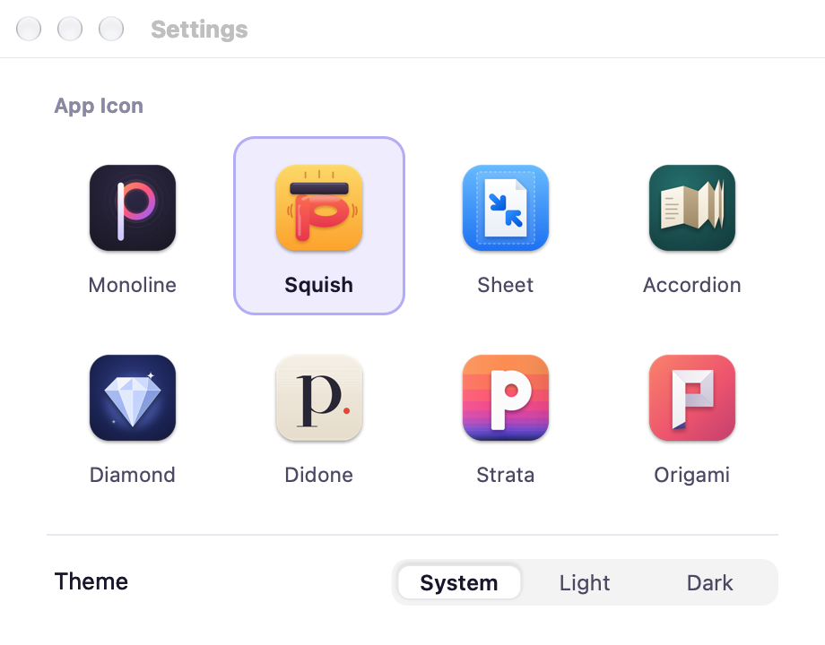
  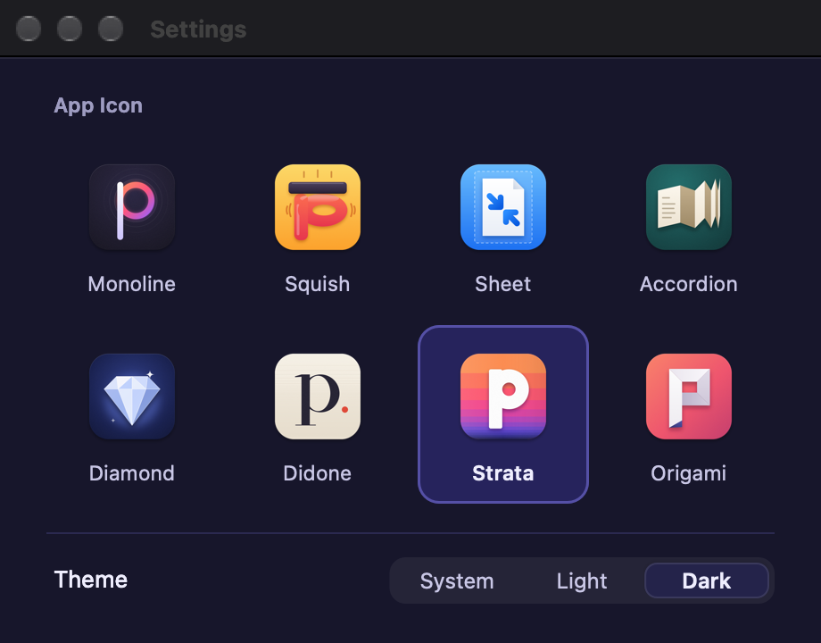
</p>

<table align="center"><tr>
<td align="center">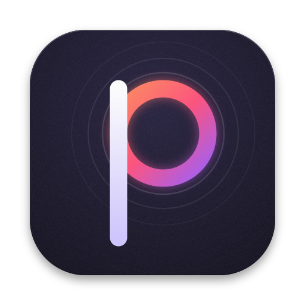<br/>Monoline</td>
<td align="center"><br/><b>Squish</b></td>
<td align="center">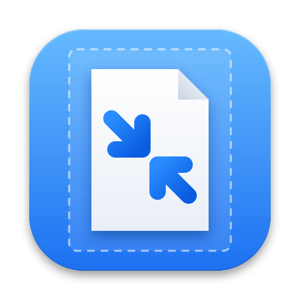<br/>Sheet</td>
<td align="center"><br/>Accordion</td>
<td align="center"><br/>Diamond</td>
<td align="center"><br/>Didone</td>
<td align="center">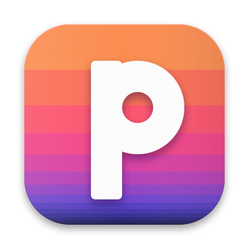<br/>Strata</td>
<td align="center">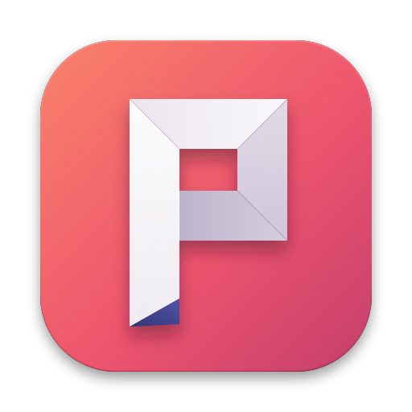<br/>Origami</td>
</tr></table>

**Look and feel**

- **One design system** (`fs_pdf_compressor/macos_theme.py`): indigo accent, lavender-tinted
  neutrals, one hairline, 8–12 pt radii — in light and dark, independent of the system accent.
- **Dark mode throughout.**

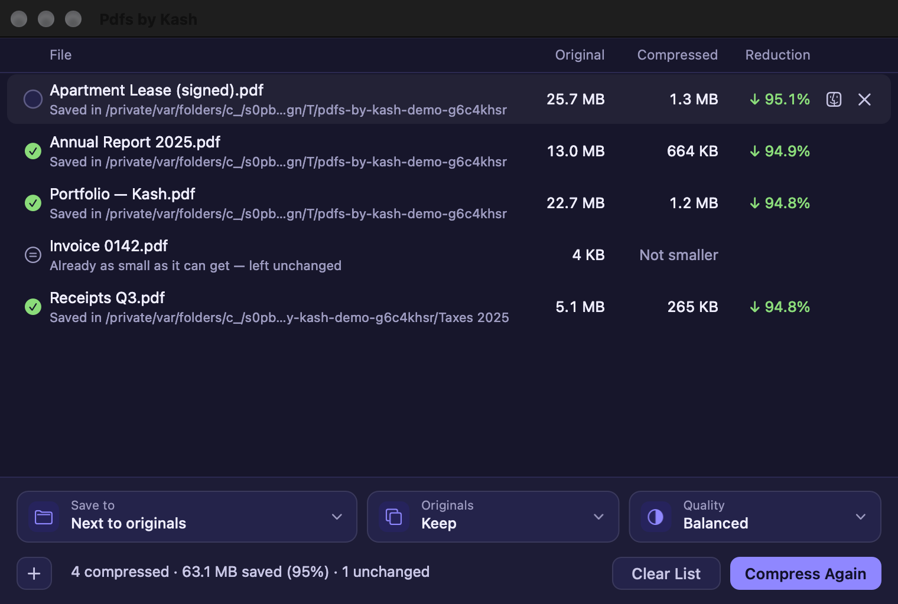

**Under the hood**

- Renamed throughout: app, bundle id `com.kaschief.pdfsbykash`, Finder Quick Action, URL scheme.
- Upstream's auto-update feed is switched off, so the fork is never replaced by an upstream build.
- About keeps the original author's credit and the AGPL notice.

## Using it

1. **Add PDFs** — drag files or folders onto the window, click **+**, or ⌘O.
2. **Check the tiles** — Save to, Originals, Quality. Each row shows where its file will go.
3. **Compress** — or press Return.
4. **Review** — sizes and reduction per file; hover a row to show it in Finder.

Keyboard: ⌘O add · Return compress · ⌘R show in Finder · Delete remove from list · Esc deselect ·
⌘A select all · ⌘, Settings · Tab moves a thin focus ring through the controls.

## Run locally

macOS 26 on Apple Silicon.

```bash
brew install python@3.12 ghostscript
python3.12 -m venv .build-venv
.build-venv/bin/pip install -r requirements-build.txt
.build-venv/bin/python native_app.py
```

Day to day:

```bash
scripts/dev.sh                 # run (or restart) the app from source
scripts/install_local_mac.sh   # tests → signed build → quit installed app → replace → reopen
```

The build pins Ghostscript 10.07.1 (10.08.0 has a `pdfwrite` regression, see the changelog);
the install script takes it from `/Applications/FS PDF Compressor.app` when Homebrew's is newer.
To build only, into `release-test/`:

```bash
DIST_DIR=release-test MACOS_GHOSTSCRIPT_SOURCE_APP="/Applications/FS PDF Compressor.app" .build-venv/bin/python build_macos.py
```

Tests and screenshots:

```bash
.build-venv/bin/python -m unittest discover -s tests
.build-venv/bin/python scripts/render_docs_screenshots.py   # off-screen, never takes focus
```

## Settings, data and compatibility

- Preferences live in the `com.kaschief.pdfsbykash` defaults domain: `AppIcon`, `Appearance`,
  `QualityIndex`, `OutputFolder`, `UseOutputFolder`, `SkipReplaceConfirmation`.
- Nothing leaves your Mac: no accounts, no network requests (the update check is off).
- The Windows and Linux apps in this repository are upstream's and unchanged, apart from the
  shared rule that an original is only replaced once it is in the Trash.

## Development and documentation

| Where | What |
|---|---|
| [docs/pdfs-by-kash-changes.md](docs/pdfs-by-kash-changes.md) | Running list of every change since the fork — update it with each change |
| [CHANGELOG.md](CHANGELOG.md) | Release notes (upstream history below the fork entry) |
| `fs_pdf_compressor/macos_theme.py` | Design tokens: colour, shape, focus, motion |
| `fs_pdf_compressor/compression_queue.py` | The list's model: one state per file |
| `macos_dock_tile/` | Dock tile plug-in that shows the chosen icon while the app is closed |
| `scripts/render_docs_screenshots.py` | Regenerates `docs/screenshots/` |
| `scripts/dev.sh`, `scripts/install_local_mac.sh` | Dev run; rebuild + install + reopen |

### Commits

Commit messages must follow [Conventional Commits](https://www.conventionalcommits.org/) (`type(scope): summary`, scope optional). The rule is enforced by `.githooks/commit-msg`. Git does not switch repo hooks on by itself, so after a fresh clone run this once in the repo:

```shell
git config core.hooksPath .githooks
```

### Design history

Design decisions are shown as mockups before they're built. The explorations are kept:

- [App icon studies](docs/icon-studies/index.html) — the eight icons at every size, in a mock Dock.
- [Settings bar directions A–D](docs/design/settings-bar/index.html) — A (setting tiles) was chosen;
  also the file-list states, selection and reveal proposals.
- [Settings alignment](docs/design/settings-v2/index.html) — Settings reduced to icon and theme,
  the opaque option card and the design tokens.

Branches: `pdfs-home` is the only branch. Explorations happen on short-lived branches and are
merged here when approved; their work lives on in the folders above.

## Origins and license

Pdfs by Kash is a modified version of **FS PDF Compressor** © 2026 Daniel Lares
([source](https://github.com/gitlares/fs-pdf-compressor)), and is distributed under the
**GNU Affero General Public License v3.0 or later** — see [LICENSE](LICENSE). Ghostscript is
© Artifex Software, AGPL-3.0. Third-party notices: [THIRD_PARTY_NOTICES.md](THIRD_PARTY_NOTICES.md).
The original README is kept at [docs/UPSTREAM-README.md](docs/UPSTREAM-README.md).
